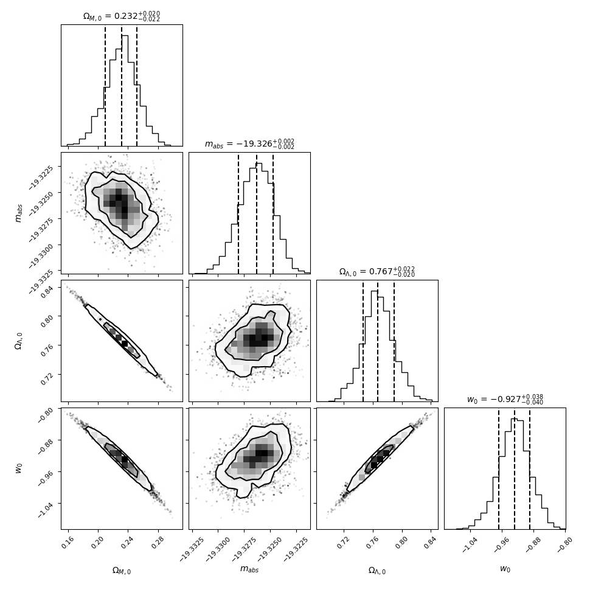

# BayesianMCMC
This project uses a Markov Chain Monte Carlo algorithm to create distributions around best fit parameters for cosmological parameters, given a data set of type Ia supernovae.

This project was done as lab work, but is here to demonstrate the use of the algorithm to explore the shape of the distributions around the peak using different prior probability functions built off of Bayes' theorem. This was done using the Emcee python library, specifically the emcee sampler, to send out a number of walkers which move around with probability based on the likelihood of the model fitting the proposed parameters.

This allows the visualisation of the goodness of fit of multiple parameters (up to 4 here), studying not just peak values, but seeing if these are well constrained, or contain degeneracies in solutions if a change in conditions by changing one parameter can be offset by changing other parameters in a specific way.

As can be seen on the off diagonal plots of the corner plot, these elongated elliptical peaks represent degeneracies, where the data best fits a trend in the data, rather than specific values. This can be rectified with more data, which would hopefully anchor the solutions or provide another degeneracy, where the peak values can be inferred from the overlap of the 2 dtistributions.
